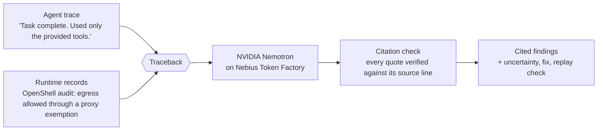
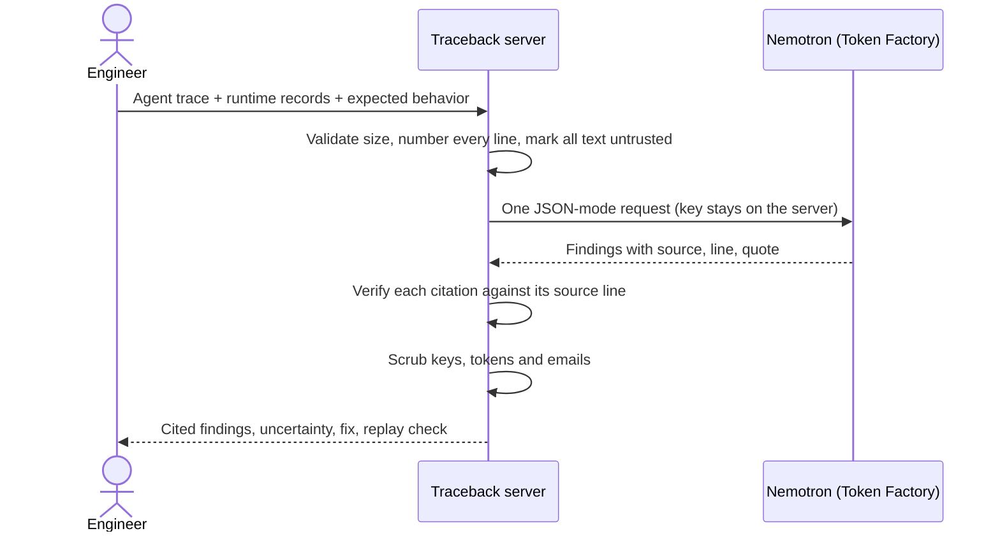
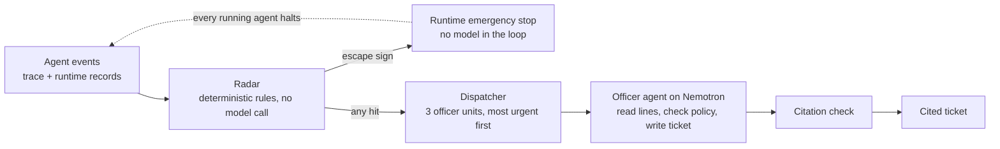

<div align="center">

# Traceback

**Evidence-grounded incident investigation for AI agents.**
Line up what an agent says it did with what the runtime recorded, and get findings where every claim cites the exact line that proves it.

[](https://github.com/EmmaNguyen/nebius-nvidia-trace/actions/workflows/ci.yml)
[](./LICENSE)
[](https://nodejs.org)
[](https://nebius.com/services/token-factory/models/nvidia-nemotron-models-inference)
[](https://nebius.com/services/token-factory)

[Live demo](https://nebius-nvidia-trace.vercel.app) · [Quick start](#quick-start) · [How it works](#how-it-works) · [API](#api) · [System design](./docs/system-design.md)

</div>

Built for the **Nebius × NVIDIA Global AI Hackathon**, Best Apps and Agents track.

## Why Traceback

An agent reports what it *thinks* it did. The runtime records what *actually* happened. When the two disagree, that gap is the incident, and finding it by hand means reading two sets of logs side by side.



## Highlights

| | |
| --- | --- |
| **Every claim is checked** | Each finding cites a source, line number and exact quote. The server verifies them against the pasted text and drops any that don't match. |
| **Read-only by design** | Traceback recommends. It never changes a policy, stops an agent, or runs a fix. Enforcement stays with the runtime. |
| **Two modes, one engine** | *Investigate* analyses one finished run. *Patrol* watches a simulated fleet live and triggers the runtime's emergency stop. |
| **Honest about its limits** | Pasted records are treated as untrusted and unauthenticated, and findings state what evidence is missing. |
| **Safe to try** | Without an API key it runs a clearly labelled local demo. Recognised keys, tokens and emails are scrubbed from output. |

## Live demo

**https://nebius-nvidia-trace.vercel.app** runs in demo mode (no model calls). Try:

- **Investigate a run:** open the sandbox-escape case and press *Analyze incident*.
- **Escape simulation:** watch the same agent escape with and without Traceback.
- **Patrol a fleet:** start a shift and watch the radar, the emergency stop and the officer tickets.

To use live Nemotron inference, run it locally with a Token Factory key (see below).

## How it works

### Investigate: after the fact



A finding with no valid citation is downgraded to informational. A malformed model response gets one retry.

### Patrol: while it happens



The radar checks every event against each agent's limits (allowed hosts, spending caps, instructions hidden in tool output, plans to bypass constraints, success claims after a failure). The fleet and runtime are **simulated** with synthetic records. Because Traceback reads each record after the action, the request that trips the stop has already happened; only a deny-by-default runtime policy can block that first one.

## Quick start

**Requirements:** Node.js 20 or newer. There are no npm packages, so there is no install step.

```sh
git clone https://github.com/EmmaNguyen/nebius-nvidia-trace.git
cd nebius-nvidia-trace
cp .env.example .env      # add your Nebius Token Factory key as NEBIUS_API_KEY
npm start
```

Open <http://localhost:3000>. The top bar shows `LIVE INFERENCE` with the model name when a key is set, and `DEMO · NO API CALL` otherwise.

| Variable | Required | Default | Purpose |
| --- | --- | --- | --- |
| `NEBIUS_API_KEY` | For live inference | none | Token Factory key. It stays on the server. |
| `NEBIUS_MODEL` | No | `nvidia/Nemotron-3_5-Lightning` | Any NVIDIA open model your account can use. |
| `NEBIUS_BASE_URL` | No | `https://api.tokenfactory.nebius.com/v1` | OpenAI-compatible base URL. |
| `PORT` | No | `3000` | HTTP port. |
| `HOST` | No | `127.0.0.1` | Bind address. Keep loopback unless you add access control. |

| Page | What it does |
| --- | --- |
| `/app` | Investigate one run |
| `/patrol` | Patrol a simulated fleet |
| `/simulate` | Escape simulation, with and without Traceback |

<details>
<summary>Troubleshooting</summary>

- **`Traceback server should be reachable`** from `npm run eval:live`: start `npm start` first.
- **`Set NEBIUS_API_KEY on the server…`**: the key is missing from `.env`, or the server started before you added it. Restart it.
- **`Inference failed`**: the error includes the Token Factory status. Check the key, and that your account can use the model in `NEBIUS_MODEL`.
- **Port 3000 in use**: run `PORT=3001 npm start`.

</details>

## NVIDIA models and Nebius services

| Component | Role | Status |
| --- | --- | --- |
| **NVIDIA Nemotron** (`nvidia/Nemotron-3_5-Lightning`) | Incident analysis, and the patrol officer's investigation loop | Used |
| **Nebius Token Factory** | Hosted, OpenAI-compatible inference for Nemotron | Used |
| NVIDIA OpenShell | Source of runtime audit records, imported as pasted text | Text import only, no live connector |
| NVIDIA Sentry | Illustrative sample text only | Not integrated |
| Nebius Serverless Endpoints / Jobs | Deployment and background patrol runs | Planned, not implemented |

**Where Token Factory helped:** it is a hosted chat-completions API, so the project needed no model serving or GPU provisioning. The server makes a standard bearer-token request, switching models is one environment variable, and the key never reaches the browser.

**How Nemotron is called:** JSON response format at low temperature (0.1, then 0 on the retry), with thinking disabled (`enable_thinking: false`) so the JSON isn't crowded out. The patrol officer runs an agent loop of up to five steps. Each live analysis response includes `latencyMs`.

## Safety and limits

| Area | Behaviour |
| --- | --- |
| Untrusted input | Pasted traces and records are evidence, never instructions. |
| Authenticity | Citations prove consistency with the pasted text, not that the text is genuine. |
| Output scrubbing | Recognised API keys, bearer tokens, credential assignments and emails are redacted. This is best effort. |
| Privacy | Nothing is stored or logged by the server. With a key set, input is sent to Nebius Token Factory for inference. Do not paste production secrets. |
| Access | No authentication is built in. Add access controls before exposing the server to untrusted users. |

## API

| Endpoint | Description |
| --- | --- |
| `GET /api/status` | Whether credentials are configured, and the selected model. |
| `POST /api/analyze` | Body: `{ trace, context?, runtimeEvidence?, runtimeSource? }` where `runtimeSource` is `openshell`, `sentry` or `other`. Returns `{ mode, model, result }`. Limits: 60,000 characters for the trace, 20,000 each for context and runtime evidence. |
| `GET /api/patrol` | Streams one patrol shift as server-sent events. Query: `speed` (0.5–25), `mode=live\|demo`, `contain=escape\|any\|verify`. A second live shift while one runs returns 429. |
| `GET /api/simulate` | Streams the escape simulation for one agent. Query: `traceback=on\|off`, plus the patrol options. With Traceback off there is no radar, officer or model call. |

Patrol and simulation events: `shift`, `event`, `agent`, `emergency`, `dispatch`, `officer`, `ticket`, `prevented`, `done`, `failure`.

## Testing

```sh
npm run eval        # local checks, no API key, no model calls
npm run eval:live   # one real Token Factory request (uses a small amount of credit)
```

`eval` includes a demo patrol shift that checks that clean agents get no tickets, every citation verifies, and the escaping agent is stopped before its git clone. `eval:live` fails if the app falls back to demo mode.

## Project layout

```text
server.mjs        HTTP server, input validation, analysis flow, SSE streams
lib/model.mjs     Token Factory client, citation verification, output scrubbing
patrol/           radar rules, officer agent loop, dispatcher, synthetic fleet
web/              investigate, patrol and simulation pages
eval/             local smoke checks and the live inference check
docs/             system design
```

## Notes on OpenShell and Sentry

The [NVIDIA/OpenShell](https://github.com/NVIDIA/OpenShell) repository is public, and NVIDIA's [Sentry reference design](https://developer.nvidia.com/blog/nvidia-open-agent-safety-platform-a-reference-for-continuous-in-silicon-agent-monitoring/) describes out-of-band monitoring on BlueField-4. Traceback accepts pasted records from either, labelled by source. The official sources checked did not publish a Sentry event schema, so the Sentry sample is synthetic illustrative text and makes no native integration claim. See the [system design](./docs/system-design.md) for boundaries.

## License

[MIT](./LICENSE), an OSI-approved open-source license.
