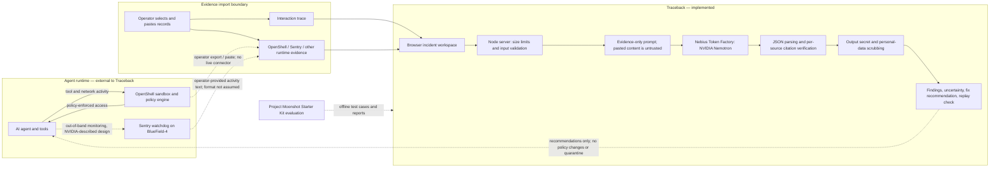
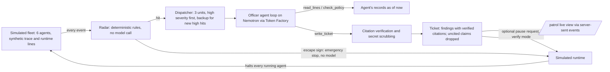

# Traceback system design

Traceback investigates an incident from two possible evidence streams: the agent's own interaction trace and runtime activity records supplied by the user. It produces recommendations; it is not an enforcement or observability agent.

## Trust boundaries and source handling

- The browser submits the trace, optional expected-behavior context, and optional runtime evidence to the local Node server. Inputs have per-field limits; incident content is not persisted by the app.
- The model receives all pasted fields as untrusted data. Instructions embedded in a trace do not become application instructions. Expected-behavior context helps frame the analysis but is not a citeable event source.
- Findings cite a source ID (`trace`, `openshell`, `sentry`, or `other`), a one-based line, and an exact quote. The server checks source, line, and quote against the matching supplied text. Citation verification establishes consistency with the pasted text, not that the text is authentic.
- Recognized credentials and email addresses are scrubbed from returned analysis. This is a best-effort output safeguard, not a substitute for avoiding sensitive production data.
- When configured, trace, context, and runtime evidence are sent to Nebius Token Factory for Nemotron inference. Keep the API key on the server.
- OpenShell and Sentry remain responsible for runtime monitoring and policy enforcement. Traceback cannot make or execute policy decisions.

## OpenShell and Sentry integration status

The [NVIDIA/OpenShell repository](https://github.com/NVIDIA/OpenShell) is public and describes a runtime with a gateway, sandbox, policy engine, and provider access. NVIDIA's documentation describes OpenShell audit records in OCSF and runtime inspection for supported traffic. Traceback currently accepts operator-pasted OpenShell output; it does not call the OpenShell API or subscribe to logs.

NVIDIA describes Sentry as an out-of-band agent watchdog using BlueField-4 and DOCA to correlate agent interactions, policy decisions, and tool access. The official [Sentry reference-design article](https://developer.nvidia.com/blog/nvidia-open-agent-safety-platform-a-reference-for-continuous-in-silicon-agent-monitoring/) describes the design. In the official sources checked for this implementation, we did not find a separate public Sentry source repository or a native event schema/SDK to integrate against. Therefore:

- The “Load Sentry example” uses synthetic, illustrative normalized text. It is explicitly not a native Sentry event format or real telemetry.
- A user may select Sentry and paste evidence, but the label is not authenticated and does not assert a live connection.
- A real adapter should be added only against a published or vendor-provided schema/API, with provenance and signature validation designed separately.

References: [NVIDIA OpenShell](https://github.com/NVIDIA/OpenShell), [Add runtime controls to AI agents with NVIDIA OpenShell](https://developer.nvidia.com/blog/add-runtime-controls-to-ai-agents-with-nvidia-openshell/), and [NVIDIA Open Agent Safety Platform reference design](https://developer.nvidia.com/blog/nvidia-open-agent-safety-platform-a-reference-for-continuous-in-silicon-agent-monitoring/).

## Patrol mode

Patrol mode adds an orchestrated, agentic path next to the single-request analysis. It runs entirely against a simulated fleet with synthetic records.

- The radar is deterministic and only says "worth a closer look". The officer must confirm each hit by reading the cited lines, and may dismiss a hit by citing a contradicting line.
- The officer's tools are read-only. `read_lines` returns at most 20 numbered lines; evidence lines are passed to the model as untrusted data. The loop is capped at five model calls; if no ticket is written, the ticket falls back to the radar-verified evidence and is marked as a fallback.
- Every ticket citation is checked against the agent's records at the moment the ticket is written. Findings without a verified citation are removed from the ticket and listed as dropped.
- Containment is a policy (`contain`). By default (`escape`) the radar's off-route and exemption rules are tripwires: Traceback immediately triggers the runtime's emergency stop, with no model in the loop, and the simulated runtime halts every running agent and logs the decision as a runtime line. `any` makes every radar hit a tripwire; `verify` pauses one agent only after a verified high-severity ticket. Officers investigate in every mode, so there is always a cited report.
- Traceback never stops an agent itself; it triggers the runtime's stop. It reads records after each action, so the action that trips the stop has already happened. Blocking the first request needs a deny-by-default runtime policy (for example, no maintenance-proxy exemption in OpenShell). A real deployment would need the runtime to expose an emergency-stop control and enforce it under its own policy.
- Only one live shift runs at a time to bound Token Factory usage. Demo mode runs the same orchestration with a deterministic officer and no model calls.

## Evaluation boundary

Project Moonshot runs as an evaluation harness outside the incident request path. The local project checks exercise Traceback itself in deterministic demo mode. Starter Kit cookbook runs against the configured model endpoint test model outputs; they do not replace app-level checks for line citation validation, input handling, or secret scrubbing. Record model/configuration and rerun relevant checks after changes to prompts, models, or evidence handling.
